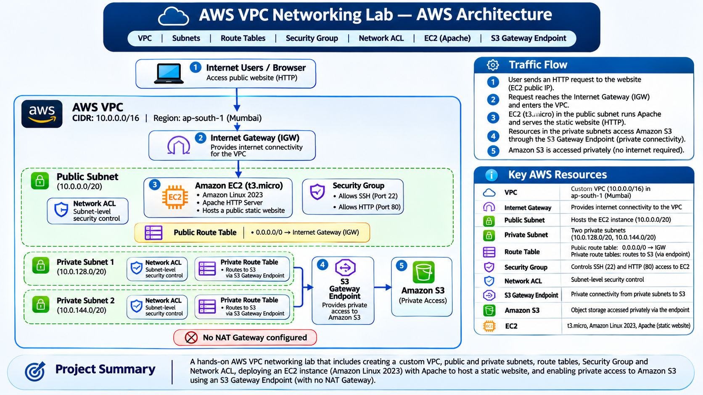

# AWS VPC Networking Lab

A hands-on AWS networking project built in the **Asia Pacific (Mumbai) Region (`ap-south-1`)**. This lab demonstrates a custom Amazon VPC, public and private subnet segmentation, route-table configuration, network security, an EC2-hosted Apache website, and private-subnet connectivity to Amazon S3 through an S3 Gateway Endpoint.

## Project Architecture



The public EC2 instance serves the static website. Separately, the S3 Gateway Endpoint is associated with both private route tables, providing a private route from resources in those subnets to Amazon S3, subject to applicable IAM, endpoint, and bucket policies.

## Project Objectives

- Create and inspect a custom VPC and its IPv4 CIDR.
- Understand public and private subnet design.
- Configure route tables and subnet associations.
- Attach an Internet Gateway and configure public routing.
- Configure an EC2 Security Group for HTTP and restricted SSH access.
- Review the subnet-level Network ACL.
- Launch EC2 and host a static website using Apache HTTP Server.
- Create an S3 Gateway Endpoint and associate it with both private route tables.
- Verify the configuration and document the work with screenshots.

## AWS Environment

| Setting | Configuration |
|---|---|
| Region | Asia Pacific (Mumbai) — `ap-south-1` |
| VPC | `MyCloudVPC_project-vpc` |
| VPC CIDR | `10.0.0.0/16` |
| Internet Gateway | `MyCloudVPC_project-igw` |
| EC2 instance | `MyCloudVPC-EC2` |
| Instance type | `t3.micro` |
| Operating system | Amazon Linux 2023 |
| Web server | Apache HTTP Server (`httpd`) |
| Website document root | `/var/www/html` |
| S3 endpoint | Amazon S3 Gateway Endpoint |
| NAT Gateway | Not configured |

## Network Design

The VPC contains four subnets across two Availability Zones.

| Subnet | IPv4 CIDR | Purpose |
|---|---|---|
| Public Subnet 1 | `10.0.0.0/20` | Hosts the EC2 web server |
| Public Subnet 2 | `10.0.16.0/20` | Additional public subnet |
| Private Subnet 1 | `10.0.128.0/20` | Private network segment |
| Private Subnet 2 | `10.0.144.0/20` | Private network segment |

### Internet Gateway and public route table

The Internet Gateway is attached to the custom VPC. The public route table, `MyCloudVPC_project-rtb-public`, is explicitly associated with both public subnets.

| Destination | Target |
|---|---|
| `10.0.0.0/16` | `local` |
| `0.0.0.0/0` | Internet Gateway |

The EC2 instance is deployed in Public Subnet 1 with a public IPv4 address. The public route table provides the route to the Internet Gateway; the Security Group controls which inbound traffic is permitted.

### Private route tables and S3 Gateway Endpoint

The private subnets use separate route tables:

- `MyCloudVPC_project-rtb-private1-ap-south-1a`
- `MyCloudVPC_project-rtb-private2-ap-south-1b`

The endpoint `MyCloudVPC_project-vpce-s3` is a **Gateway** endpoint for Amazon S3 and has **Available** status. It is associated with both private route tables. Each route table has an S3 managed prefix-list route pointing to the endpoint.

This provides a private route from resources in those associated subnets to Amazon S3 through the AWS network. Actual access still depends on IAM permissions and any applicable endpoint and S3 bucket policies.

**No NAT Gateway is configured.** The private subnets therefore do not have general internet egress through a NAT Gateway. The S3 Gateway Endpoint provides a specific route to S3; it is not a general-purpose internet connection.

## Network Security

### EC2 Security Group

The custom Security Group `MyCloudVPC-EC2-SG` is attached to the EC2 instance's network interface.

| Rule | Protocol | Port | Source / purpose |
|---|---|---:|---|
| HTTP | TCP | 80 | `0.0.0.0/0` for public website access |
| SSH | TCP | 22 | Administrator's public IP address (`/32`) |

Keep SSH restricted to a trusted administrator IP. Do not expose port 22 to `0.0.0.0/0` for routine administration.

### Network ACL

The default Network ACL is associated with the VPC subnets. The inspected default inbound and outbound rules allow traffic, with the final `*` rule denying traffic not matched by an earlier rule.

Network ACLs operate at the subnet level and are stateless. Security Groups operate at the network-interface/resource level and are stateful.

## EC2 Web Server

The instance `MyCloudVPC-EC2` was launched with Amazon Linux 2023, instance type `t3.micro`, Public Subnet 1 (`10.0.0.0/20`), a public IPv4 address, the custom Security Group, and the `MyCloudVPC-Key` key pair.

Apache HTTP Server serves the static website from `/var/www/html`.

### Apache setup commands

Run these commands on the EC2 instance:

```bash
sudo dnf update -y
sudo dnf install httpd -y
sudo systemctl enable --now httpd
sudo systemctl status httpd
```

Check the website files:

```bash
sudo ls -la /var/www/html
```

Open the instance's public IPv4 address in a browser:

```text
http://<EC2-PUBLIC-IP>
```

Replace `<EC2-PUBLIC-IP>` with the current public IPv4 address shown in the EC2 console.

## Project Screenshots

The `images/` directory contains the console screenshots and website evidence.

| File | Description |
|---|---|
| `images/vpc-overview.png` | Custom VPC overview |
| `images/subnets.png` | Public and private subnet configuration |
| `images/route-table-explicit.png` | Explicit subnet associations |
| `images/route-table-main-association.png` | Main route table association view |
| `images/security-group.png` | EC2 Security Group configuration |
| `images/s3-endpoint.png` | S3 Gateway Endpoint and its two private route-table associations |
| `images/ec2-instance.png` | EC2 instance configuration |
| `images/apache-status.png` | Apache service status |
| `images/hosted-website.png` | Website running on the EC2 public IP |

Keep the screenshot filenames exactly as listed, or update these paths to match the actual filenames in your repository.

## Repository Structure

```text
vpc-networking-lab/
├── README.md
├── index.html
├── architecture-diagram.png
└── images/
    ├── vpc-overview.png
    ├── subnets.png
    ├── route-table-explicit.png
    ├── route-table-main-association.png
    ├── security-group.png
    ├── s3-endpoint.png
    ├── ec2-instance.png
    ├── apache-status.png
    └── hosted-website.png
```

If the website uses inline CSS, omit `style.css`.

## Key Learning Outcomes

- VPC CIDR planning and subnet segmentation.
- Public versus private subnet design.
- Internet Gateway attachment and route-table configuration.
- Explicit subnet associations and main route-table behavior.
- Security Group versus Network ACL responsibilities.
- EC2 deployment and Apache web-server setup.
- S3 Gateway Endpoint configuration and private route-table associations.
- AWS networking verification, troubleshooting, and documentation.

## Security Notes

- Never upload `.pem` private keys, AWS access keys, credentials, or passwords to GitHub.
- Restrict SSH inbound access to a trusted administrator IP (`/32`).
- Review Security Group, Network ACL, IAM, endpoint, and S3 bucket policies before using a similar design in production.
- This is a learning lab, not a production-ready reference architecture.

## Cost Awareness and Cleanup

AWS charges depend on account eligibility, usage, and current pricing. Review AWS Billing and Cost Management while using the lab.

When finished, stop or terminate the EC2 instance and remove resources that are no longer needed. Review unused VPC endpoints, Elastic IP addresses, and any other billable resources. Do not remove resources still used by another project.

## Author

**AWS Cloud / Cloud Support learning portfolio project**

Built as part of a hands-on learning path focused on AWS infrastructure, Linux, networking, troubleshooting, and cloud operations.
